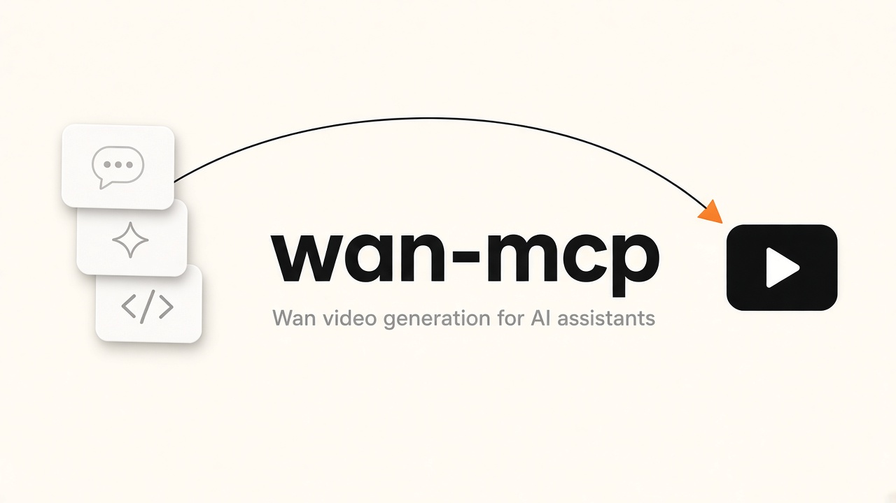

# wan-mcp

Wan video generation for AI assistants

This lets AI assistants in chat apps and code editors make short videos from a text description, using Wan. You type something like "make a 5 second video of a lake at sunrise" and the assistant gives you back a video. It is for people who use those apps and want the assistant to create the clip for them. You need your own Wan API key from Alibaba Cloud Model Studio (DashScope). MCP is a standard plug that lets AI assistants use outside tools.

stdio MCP server for [Alibaba Wan 3.0 video](https://www.alibabacloud.com/help/en/model-studio/wan3-video-generation-api-reference) through the official Model Studio API only. It exposes three tools so an assistant can create a task, poll status, and download the finished mp4.

Tests never make a live paid generate call.

Official source of truth: [Wan 3.0 video generation API reference](https://www.alibabacloud.com/help/en/model-studio/wan3-video-generation-api-reference). Tool schemas expose only fields on that page (no `enable_thinking`).

## Supported model and features

Fixed model: `wan3.0-video`.

| Feature | Support |
| --- | --- |
| Text to video | `prompt` (Chinese or English, max 20000 characters) |
| First / last frame | `media` types `first_frame`, `last_frame` (max 1 each) |
| Reference media | `reference_image` (max 10), `reference_video` (max 5, total at most 15s), `reference_audio` (max 5, total at most 15s) |
| File or link input | `file` (max 1) or `link` (max 1), not together |
| Resolution | `1080P`, `720P`, `480P` (official default 1080P) |
| Aspect ratio | `adaptive`, `16:9`, `4:3`, `1:1`, `3:4`, `9:16` (official default adaptive) |
| Duration | integer 2 to 30 seconds, or `-1` smart duration (official default 5) |
| Audio, seed, watermark | `audio` (default true), `seed` in `[0, 2147483647]`, `watermark` (default false) |
| Regions | `singapore` (`ap-southeast-1`) and `beijing` (`cn-beijing`) |

`reference_*` / `file` / `link` cannot be combined with `first_frame` / `last_frame`. Create calls send `X-DashScope-Async: enable`. Task statuses: `PENDING`, `RUNNING`, `SUCCEEDED`, `FAILED`, `CANCELED`, `UNKNOWN`. On `SUCCEEDED`, `video_url` is valid for 24 hours. `wan_wait_for_video` downloads the mp4 to `WAN_OUTPUT_DIR`.

## Requirements

- Python 3.10 or newer
- An Alibaba Cloud Model Studio workspace and DashScope API key

## Install

```bash
git clone https://github.com/Matinrahimik/wan-mcp.git
cd wan-mcp
python3 -m venv .venv
.venv/bin/pip install -e .
cp .env.example .env
```

Edit `.env` with your key and workspace id. For development tests:

```bash
.venv/bin/pip install -e ".[dev]"
.venv/bin/pytest
```

HTTP is mocked. There is no live paid generate call in CI or smoke tests.

`run.py` loads `.env` from the repo root (without overwriting variables already in the environment), resolves optional JSON secrets, then execs the `wan-mcp` console script (or `python -m wan_mcp` if the script is not on PATH).

## Environment variables

Get an API key from [Alibaba Cloud Model Studio](https://www.alibabacloud.com/help/en/model-studio/get-api-key). `WAN_WORKSPACE_ID` is the Model Studio workspace id used as the `{WorkspaceId}` host prefix.

Required:

| Env | Meaning |
| --- | --- |
| `DASHSCOPE_API_KEY` | DashScope API key (Bearer token) |
| `WAN_WORKSPACE_ID` | Model Studio workspace id |

Optional:

| Env | Meaning |
| --- | --- |
| `WAN_REGION` | `singapore` or `beijing`. Defaults to `singapore` if unset. |
| `WAN_OUTPUT_DIR` | Directory for SUCCEEDED mp4 files. Defaults to `./wan-output` in the current working directory. |
| `WAN_SECRETS_FILE` | Path to a JSON object with `api_key`, `workspace_id`, and `region`. Used only for fields still missing from the environment. |
| `WAN_SECRETS_ROOT` | Directory of `<id>/wan.json` files. Used when env vars (and `WAN_SECRETS_FILE`) are incomplete. |
| `WAN_AGENT_ID` | Subdirectory name under `WAN_SECRETS_ROOT` when more than one `wan.json` exists. |
| `WAN_TEST_MODE=1` | Refuses live Model Studio HTTP unless an httpx client is injected. Set in unit tests. |

Resolution order: environment variables, then `WAN_SECRETS_FILE`, then `WAN_SECRETS_ROOT/<WAN_AGENT_ID>/wan.json`, then a single `WAN_SECRETS_ROOT/*/wan.json`. Several matches without `WAN_AGENT_ID` is an error. Values already set in the environment are never overwritten by files.

Secret file shape:

```json
{
  "api_key": "sk-your-dashscope-api-key",
  "workspace_id": "your-model-studio-workspace-id",
  "region": "singapore"
}
```

## MCP config

Replace `/absolute/path/to/wan-mcp` with the clone path on your machine.

### Cursor (`~/.cursor/mcp.json`)

```json
{
  "mcpServers": {
    "wan": {
      "command": "/absolute/path/to/wan-mcp/.venv/bin/python",
      "args": ["/absolute/path/to/wan-mcp/run.py"],
      "env": {
        "DASHSCOPE_API_KEY": "sk-your-dashscope-api-key",
        "WAN_WORKSPACE_ID": "your-model-studio-workspace-id",
        "WAN_REGION": "singapore"
      }
    }
  }
}
```

### Claude Desktop (`claude_desktop_config.json`)

On macOS this file is `~/Library/Application Support/Claude/claude_desktop_config.json`. On Windows it is `%APPDATA%\Claude\claude_desktop_config.json`.

```json
{
  "mcpServers": {
    "wan": {
      "command": "/absolute/path/to/wan-mcp/.venv/bin/python",
      "args": ["/absolute/path/to/wan-mcp/run.py"],
      "env": {
        "DASHSCOPE_API_KEY": "sk-your-dashscope-api-key",
        "WAN_WORKSPACE_ID": "your-model-studio-workspace-id",
        "WAN_REGION": "singapore"
      }
    }
  }
}
```

If you keep credentials in the repo `.env` instead, you can omit the `env` object. `run.py` will load that file.

## Tools reference

### `wan_create_video`

Create a Wan 3.0 video-synthesis task. Asynchronous create: sends `X-DashScope-Async: enable`. Returns `task_id` and `task_status` (typically `PENDING`). Does not invent fields (no `enable_thinking`).

| Param | Type | Required | Description |
| --- | --- | --- | --- |
| `prompt` | string | no (prompt or media) | Text prompt, Chinese or English. Max 20000 characters. In reference mode, "Image 1" / "Video 1" / "Audio 1" index media of that type in array order. |
| `media` | array of objects | no (prompt or media) | `input.media[]` items. Each item: `type` plus `url`. |
| `media[].type` | enum | yes (per item) | `first_frame`, `last_frame`, `reference_image`, `reference_video`, `reference_audio`, `file`, `link`. |
| `media[].url` | string | yes (per item) | Public `http(s)` URL, or for images `data:{MIME_type};base64,...`. |
| `resolution` | enum | no | `1080P`, `720P`, `480P`. Official default 1080P. |
| `ratio` | enum | no | `adaptive`, `16:9`, `4:3`, `1:1`, `3:4`, `9:16`. Official default adaptive. |
| `duration` | integer | no | Seconds: 2 to 30, or `-1` smart duration. Official default 5. With video input, input plus output duration must be at most 30s. |
| `audio` | boolean | no | Official default true. Enabling or disabling audio does not affect pricing. |
| `seed` | integer | no | `[0, 2147483647]`. |
| `watermark` | boolean | no | Official default false. |
| `model` | enum | no | Fixed value `wan3.0-video`. |

Returns a Model Studio JSON object with `request_id` and `output` (`task_id`, `task_status`). On validation or API failure, `{ "error": true, "message": "..." }` plus optional `code`, `request_id`, and `status_code`.

### `wan_get_task`

Query a task by id.

| Param | Type | Required | Description |
| --- | --- | --- | --- |
| `task_id` | string | yes | Task id from `wan_create_video`. Valid for 24 hours. |

Returns Model Studio JSON with `output.task_status`, usage when present, and `output.video_url` when `SUCCEEDED`. Same error object shape as create.

### `wan_wait_for_video`

Poll until the task is terminal, then download the mp4 locally.

| Param | Type | Required | Description |
| --- | --- | --- | --- |
| `task_id` | string | yes | Task id from `wan_create_video`. Valid for 24 hours. |
| `poll_interval_seconds` | number | no | Poll interval. Official recommendation is about 15 seconds. Default 15. |
| `timeout_seconds` | number | no | Stop waiting after this many seconds. Default 900. |

On `SUCCEEDED`, downloads `video_url` to `WAN_OUTPUT_DIR` and returns the official payload plus `local_path`. On `FAILED`, `{ "error": true, "message": "..." }`. Other terminal statuses return the last task payload.

## Usage example

After the server is connected in Cursor or Claude Desktop:

1. Call `wan_create_video` with `prompt` set to a short scene, for example `A golden retriever running along a beach at sunrise, cinematic, 16:9`.
2. Read `output.task_id` from the result.
3. Call `wan_wait_for_video` with that `task_id`.
4. Open `local_path` when status is `SUCCEEDED`.

To inspect progress without downloading, call `wan_get_task` between create and wait.

## Endpoints (official)

- Singapore create: `POST https://{WorkspaceId}.ap-southeast-1.maas.aliyuncs.com/api/v1/services/aigc/video-generation/video-synthesis`
- Beijing create: `POST https://{WorkspaceId}.cn-beijing.maas.aliyuncs.com/api/v1/services/aigc/video-generation/video-synthesis`
- Poll: `GET https://{WorkspaceId}.{region-host}.maas.aliyuncs.com/api/v1/tasks/{task_id}` about every 15s

Headers:

- `Authorization: Bearer $DASHSCOPE_API_KEY`
- `X-DashScope-Async: enable` (required on create; missing yields a sync-not-supported error)
- `Content-Type: application/json`

## License

MIT. Copyright (c) 2026 Matin Rahimi.
